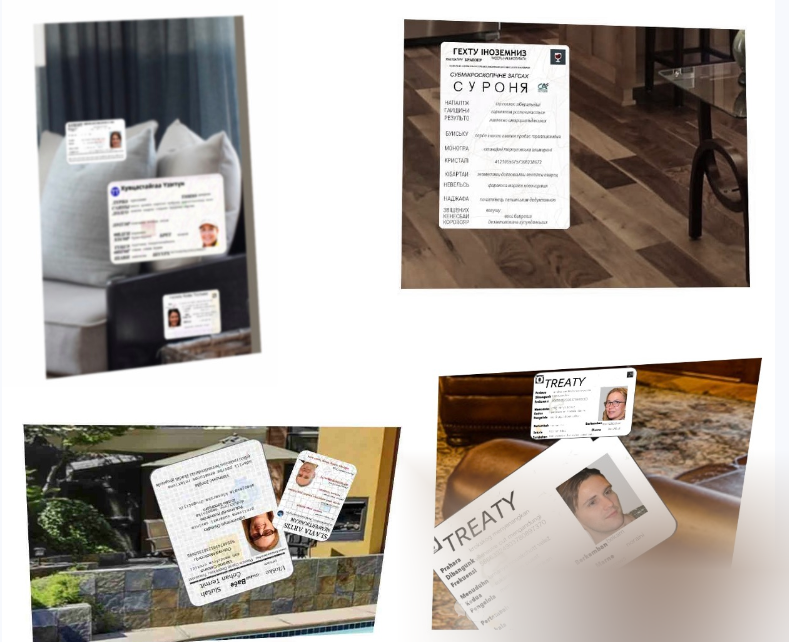
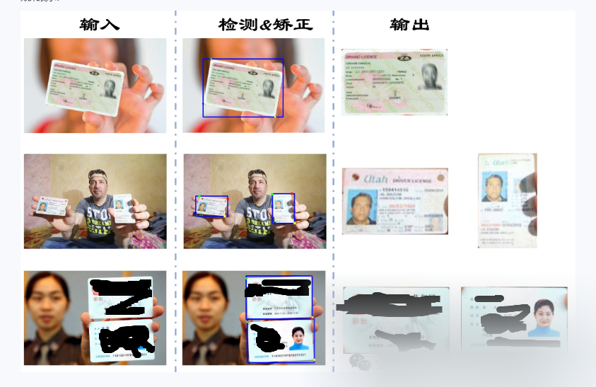
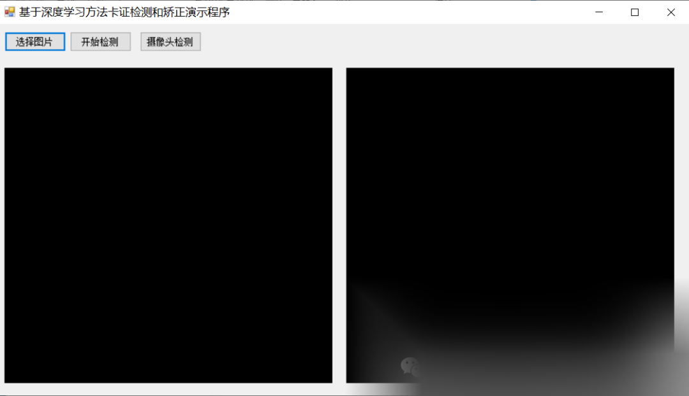
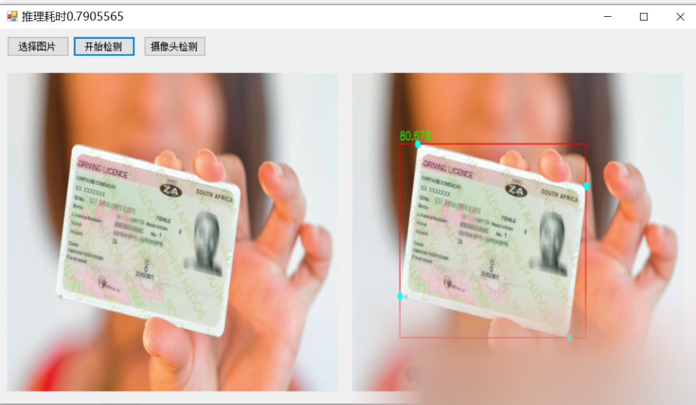

# [C#] Winform-based Scrfd Deep Learning Algorithm for Card and ID Verification and Correction

[Algorithm Introduction]

### Model Description

In scenarios such as real-person authentication and document digitization, it is necessary to automate the extraction of card information for further entry processing. This scenario typically involves two issues: one is the interference from background when recognizing card types, and the other is the distortion of text caused by the angle of card photography affecting the accuracy of OCR. Given the sensitivity of document-related data, we employ a large amount of synthetic card data for training and have reengineered the state-of-the-art face detection method SCRFD to train a card detection and correction model. This model can detect, locate, and correct various international common cards (such as ID cards, passports, driver's licenses, etc.), producing positive-angle card images free from background interference, facilitating subsequent card classification or OCR content extraction.

#### Training Data:



#### Effect Display:



### Usage and scope

Usage:

-

Inference: Input an image, if a card is present, return the card and its corner points, as well as each corrected card image.

-

Optimization: Optimize the model using proprietary data.

Target scenario:

-

Prerequisites for card-related technologies, applicable to scenarios such as OCR of cards/document classification/anti-counterfeiting of cards.

#### Code Examples

-
-
-
-
-
-
-
-
-
-
-
-
-
-
-
-
-
-

```
import cv2from modelscope.pipelines import pipelinefrom modelscope.utils.constant import  Tasks
card_detection = pipeline(Tasks.card_detection, 'damo/cv_resnet_carddetection_scrfd34gkps')img_path = 'https://design3d.oss-cn-qingdao.aliyuncs.com/MS_test_img/card_detection.jpg'result = card_detection(img_path)
# if you want to show the result, you can runfrom modelscope.utils.cv.image_utils import draw_card_detection_resultfrom modelscope.preprocessors.image import LoadImageimport matplotlib.pyplot as pltimg = LoadImage.convert_to_ndarray(img_path)cv2.imwrite('srcImg.jpg', img)img_list = draw_card_detection_result('srcImg.jpg', result)for i, img in enumerate(img_list):    plt.figure()    plt.imshow(img_list[i])
```

#### Dataset

-

SyntheticCards: Synthetic card data generated using open-source data materials and uploaded to the ModelScope DatasetHub.

-

Self-owned data: If you need to use your own data to optimize the model, please prepare annotation information in the following format. The corner order is left bottom, left top, right top, right bottom. Each corner format is (x, y, 1).

-
-
-
-
-
-
-
-

```
# <image_path> image_width image_heightbbox_x1 bbox_y1 bbox_x2 bbox_y2 (<keypoint,3>*4)......# <image_path> image_width image_heightbbox_x1 bbox_y1 bbox_x2 bbox_y2 (<keypoint,3>*4)......
```

#### Model Training

Training with the dataset SyntheticCards hosted on Modelscope DatasetHub:

-
-
-
-
-
-
-
-
-
-
-
-
-
-
-
-
-
-
-
-
-
-
-
-
-
-
-
-
-
-
-
-
-
-
-
-
-
-
-
-
-
-
-

```
import osimport tempfilefrom modelscope.msdatasets import MsDatasetfrom modelscope.metainfo import Trainersfrom modelscope.trainers import build_trainerfrom modelscope.hub.snapshot_download import snapshot_download
model_id = 'damo/cv_resnet_carddetection_scrfd34gkps'ms_ds_widerface = MsDataset.load('SyntheticCards_mini', namespace='shaoxuan')  # remove '_mini' for full dataset
data_path = ms_ds_widerface.config_kwargs['split_config']train_dir = data_path['train']val_dir = data_path['validation']
def get_name(dir_name):    names = [i for i in os.listdir(dir_name) if not i.startswith('_')]    return names[0]
train_root = train_dir + '/' + get_name(train_dir) + '/'val_root = val_dir + '/' + get_name(val_dir) + '/'cache_path = snapshot_download(model_id)tmp_dir = tempfile.TemporaryDirectory().nameif not os.path.exists(tmp_dir):    os.makedirs(tmp_dir)
def _cfg_modify_fn(cfg):        cfg.checkpoint_config.interval = 1        cfg.log_config.interval = 10        cfg.evaluation.interval = 1        cfg.data.workers_per_gpu = 1        cfg.data.samples_per_gpu = 2        return cfg
kwargs = dict(        cfg_file=os.path.join(cache_path, 'mmcv_scrfd.py'),        work_dir=tmp_dir,        train_root=train_root,        val_root=val_root,        total_epochs=1,  # run #epochs        cfg_modify_fn=_cfg_modify_fn)
trainer = build_trainer(name=Trainers.card_detection_scrfd, default_args=kwargs)trainer.train()
```

-

For more examples (such as multi-card training), please refer to: `tests/trainers/test_card_detection_scrfd_trainer.py`

-

This model uses 8 cards v100, SGD optimizer with lr=0.02, reduces learning rate by a factor of 10 at epochs 120/200/240, and produces the model at epoch 280. The remaining training hyperparameters are detailed in `mmcv_scrfd.py`.

[Interface Design]

 [Effect Demonstration]



[Implementation Code - Calling Part]

-
-
-
-
-
-
-
-
-
-
-
-
-
-
-
-
-
-
-
-
-
-
-
-
-
-
-
-
-
-
-
-
-
-
-
-
-
-
-
-
-
-
-
-
-
-
-
-
-
-
-
-
-
-
-
-
-
-
-
-
-
-
-
-
-
-
-
-
-
-
-
-
-
-
-
-
-
-
-
-
-
-
-
-
-
-
-
-
-
-
-
-
-
-
-
-
-
-
-
-
-
-
-
-
-

```
using System;using System.Collections.Generic;using System.ComponentModel;using System.Data;using System.Diagnostics;using System.Drawing;using System.Linq;using System.Text;using System.Threading.Tasks;using System.Windows.Forms;using OpenCvSharp;
namespace FIRC{    public partial class Form1 : Form    {        Mat src = new Mat();        CardDetector cd = new CardDetector();        public Form1()        {            InitializeComponent();        }
private void button1_Click(object sender, EventArgs e)        {            OpenFileDialog openFileDialog = new OpenFileDialog(); openFileDialog.Filter = "Image files (*.*)|*.jpg;"; *.png; *.jpeg; *.bmp"; openFileDialog.RestoreDirectory = true; openFileDialog.Multiselect = false; if (openFileDialog.ShowDialog() == DialogResult.OK)            {
                src = Cv2.ImRead(openFileDialog.FileName);                pictureBox1.Image = OpenCvSharp.Extensions.BitmapConverter.ToBitmap(src);
            }
        }
private void button2_Click(object sender, EventArgs e)        {            if(pictureBox1.Image==null)            {                return; }            Stopwatch sw = new Stopwatch(); sw.Start(); var results =cd.Inference(src); sw.Stop(); this.Text = "Estimation Time" + sw.Elapsed.TotalSeconds; var resultMat = cd.DrawImage(src.Clone(),results); var correctImages = cd.GetCorrectImage(src, results); for(int i=0; i<correctImages.Count; i++)            {                Cv2.ImShow("result",correctImages[i]); Cv2.WaitKey(0); }            pictureBox2.Image= OpenCvSharp.Extensions.BitmapConverter.ToBitmap(resultMat); //Convert Mat to Bitmap
        private void Form1_Load(object sender, EventArgs e)        {            cd.LoadWeights(Application.StartupPath+ "\\weights\\carddetection_scrfd34gkps.onnx");        }
        private void button3_Click(object sender, EventArgs e)        {            VideoCapture capture = new VideoCapture(0);            if (!capture.IsOpened())            {                Console.WriteLine("video not open!");                return;            }            Mat frame = new Mat();            var sw = new Stopwatch();            int fps = 0;            while (true)            {
// Capture.Read(frame);
            capture.Release();        }    }}
```

[Test Environment]

vs2019,netframework4.7.2,opencvsharp==4.8.0

[Running Demonstration Video]

https://www.bilibili.com/video/BV1CDCpYJEwF/

[References]

[1] modelscope.cn/models/iic/cv_resnet_carddetection_scrfd34gkps/summary

[2]github.com/hpc203/cv_resnet_carddetection_scrfd34gkps-opencv-dnn

[Source Code URL]


## Payment

Here is a pay link on Stripe ( https://buy.stripe.com/3cs8yP7sY87d0vu9AB ). Please contact me lonlonago@foxmail.com after funding $89, and I will send you a complete data files , thank you!


